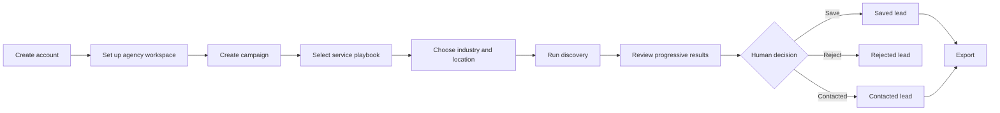
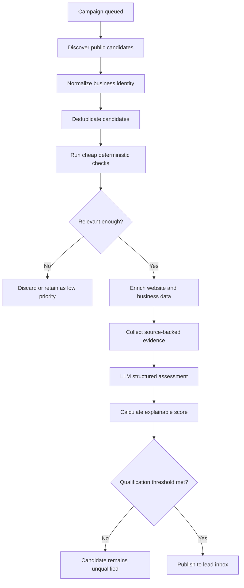
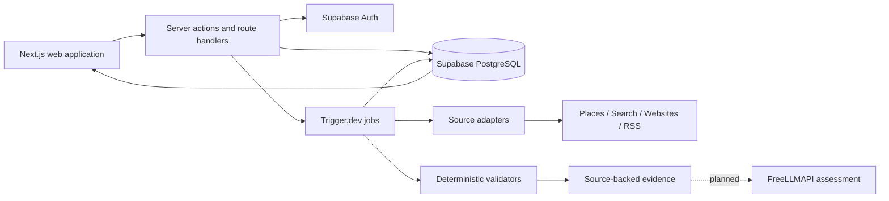

# LeadGen

LeadGen is an evidence-backed prospecting platform for small web-development agencies. It helps an agency find businesses that are likely to need a specific service and explains **why each business is worth contacting**.

The product is not a generic contact scraper. Its output is a smaller list of qualified opportunities, each supported by public evidence, a confidence score, and a public business contact path.

> **Project status:** authentication, workspace onboarding, CSV candidate import, deterministic website validation, and source-backed evidence persistence are implemented. Live discovery, LLM analysis, scoring, lead qualification, enrichment, and export remain planned.

## Current playable vertical slice

The `/campaigns/new` flow accepts a source-backed CSV, validates and deduplicates it, applies industry and location filters, runs deterministic public-website checks, and stores each observation with its source URL, timestamp, extracted value, and validator. Records remain candidates; this slice does not run LLM analysis or publish leads.

The uploaded CSV may contain illustrative records, but validation and Supabase evidence persistence are real. The UI must never describe uploaded sample records as live internet discoveries.

Required CSV columns:

```text
business_name,industry,location,description,source_url,observed_at
```

Optional columns are `website` and `contact_path`. The current run limit is 15 matching candidates and 1 MB per file.

## Read this before changing the project

Every contributor and coding agent must read these files before implementing a feature:

1. `README.md` — system behavior, flows, boundaries, and architecture
2. `PRODUCT.md` — product purpose and principles
3. `DESIGN.md` — visual language and interface rules
4. `CONTRIBUTING.md` — ownership, branches, reviews, and checks

If documents disagree, stop and ask Rachit before changing behavior. Do not silently invent a new product flow.

## MVP in one sentence

An agency describes the service it sells, the type of business it wants, and a location; LeadGen discovers public candidates, validates their need using observable signals, and returns ranked leads with traceable evidence.

## Initial customer and scope

The first customer is a **small web-development agency**, usually a team of 2–20 people.

Supported service playbooks for the first release:

- New website development
- Website redesign
- E-commerce development
- Website maintenance and performance improvement

This focus is intentional. Do not generalize the product into a marketplace for every kind of vendor until the web-agency workflow produces useful leads.

## Core product promise

Every recommended lead must answer:

1. **Why this business?** It matches the campaign's industry, location, and constraints.
2. **Why this service?** Public signals indicate a relevant website problem or opportunity.
3. **Why now?** Recent or current evidence makes outreach timely where possible.
4. **Where is the evidence?** The user can inspect the source URL, observation, and collection time.

LeadGen must never present an unexplained company record as a qualified lead.

## Shared terminology

Use these names consistently in code, UI copy, database tables, and discussions.

| Term | Meaning |
| --- | --- |
| **User** | A person using LeadGen on behalf of a web-development agency. |
| **Workspace** | The agency's account, settings, members, and campaigns. |
| **Client** | Optional: a customer for whom the agency is finding opportunities. The agency may also run campaigns for itself. |
| **Campaign** | A saved search definition: service, target industry, location, and filters. |
| **Service playbook** | The rules and signals used to evaluate need for one service, such as redesign or e-commerce. |
| **Candidate** | A discovered business that has not yet passed qualification. |
| **Signal** | A machine-observed fact, such as no official site, slow mobile performance, or a recent opening. |
| **Evidence** | The source-backed record supporting a signal: URL, observation, timestamp, and extraction metadata. |
| **Lead** | A candidate that passes minimum qualification and has enough evidence to review. |
| **Lead score** | An explainable ranking based on fit, need, timing, reachability, and evidence quality. |

Do not use “lead” for every scraped record. A record is a candidate until it passes qualification.

## User journey



### 1. Authentication

- A new user creates an account with Google OAuth or email and password.
- OAuth returns through `/auth/callback` and creates a Supabase cookie session.
- Successful authentication sends the user to `/onboarding`.
- Unauthenticated users must not access workspace, campaign, or lead data.

### 2. Workspace onboarding

The user provides:

- Username shown in the application
- Agency name
- Website, if available
- Services offered
- Default operating location
- Optional team information

Onboarding describes the agency. It does not launch a campaign automatically.

### 3. Campaign creation

The user chooses:

- Who the campaign is for: the agency or an optional client
- One service playbook
- Target business type or industry
- City, region, or country
- Optional constraints such as business size or required evidence strength

One campaign should represent one clear targeting hypothesis. Do not combine unrelated services or locations into one campaign.

### 4. Discovery and qualification

Campaign processing runs asynchronously. The UI should show progress and useful partial results instead of blocking until every check is complete.



Processing order matters:

1. Discover broadly using permitted sources.
2. Normalize names, domains, addresses, and source identifiers.
3. Deduplicate before expensive work.
4. Run deterministic filters before limited APIs or LLM calls.
5. Preserve evidence before generating conclusions.
6. Use the LLM for structured interpretation, not as the source of truth.
7. Calculate the final score in application logic.
8. Publish only leads with sufficient evidence.

### 5. Lead review

Each lead card or detail page must show:

- Business name, industry, and location
- Recommended service
- Concise reason for outreach
- Score and score breakdown
- Supporting signals and their source links
- Public business contact path, when available
- Discovery and validation timestamps
- Actions: save, reject, mark contacted, and export

A user must be able to understand and challenge the recommendation without trusting a hidden AI judgment.

## Campaign and lead states

Use explicit states rather than ambiguous loading booleans.

Campaign states:

```text
draft → queued → discovering → validating → scoring → completed
queued/discovering/validating/scoring → failed
draft/queued/discovering/validating/scoring → cancelled
```

Lead review states:

```text
new → saved → contacted
  ↘ rejected
```

Jobs must be idempotent and retry-safe. Retrying a connector or validator must not create duplicate candidates, evidence, or leads.

## Discovery sources

Planned first-party adapters:

| Source | Purpose | Rule |
| --- | --- | --- |
| Google Places API | Discover local businesses and basic public business data | Use the official API and retain its stable source identifier. |
| Brave Search API | Discover official sites, announcements, and public pages | Store the result URL and query context. |
| Public business websites | Validate website presence, technology, content, and contact paths | Respect robots.txt, rate limits, and site terms. |
| Sitemaps and RSS | Find structured or recent public updates cheaply | Prefer these over repeated page crawling where available. |
| PageSpeed Insights | Measure mobile performance and technical quality | Cache results and avoid repeated checks within the retention window. |
| Reddit or other public communities | Later source for explicit demand signals | Use only permitted public APIs or feeds; do not bypass access controls. |

LinkedIn scraping, authenticated social scraping, CAPTCHA bypassing, and access-control circumvention are outside the MVP.

## Qualification model

A lead score must be composed from visible factors, not copied directly from an LLM response.

Proposed dimensions:

- **Fit:** industry, location, and campaign constraint match
- **Need:** strength of service-specific website signals
- **Timing:** recency or evidence of an active business change
- **Reachability:** presence and quality of a public business contact path
- **Evidence quality:** source authority, agreement between sources, and freshness

The exact weights are product decisions owned by Rachit and must be versioned when introduced. The LLM may label intent or summarize evidence into a strict schema, but deterministic application logic owns thresholds and final scoring.

## Evidence requirements

Every meaningful signal should retain at least:

```ts
type Evidence = {
  sourceType: string;
  sourceUrl: string;
  observedAt: string;
  title?: string;
  excerpt?: string;
  extractedValue?: unknown;
  sourceRecordId?: string;
};
```

The implemented shape lives in `src/lib/qualification/types.ts`: `id`, `sourceType` (`csv-source`, `website` or `pagespeed`), `sourceUrl`, `observedAt`, `validator`, `signalCode`, `observation` and `extractedValue`. It stores the validator and signal code instead of `title`, `excerpt` and `sourceRecordId` for now.

Do not save only an AI summary. The original public source reference and collection time are required for traceability and revalidation.

## System architecture



### Responsibilities

- **Next.js:** pages, server-rendered application shell, route handlers, and user interactions
- **Supabase Auth:** Google OAuth, email/password authentication, and cookie sessions
- **Supabase PostgreSQL:** workspaces, campaigns, candidates, evidence, scores, and review states
- **Trigger.dev:** asynchronous discovery, validation, retries, and progress events
- **Source adapters:** one bounded module per external source
- **Deterministic validators:** website existence, HTTP status, performance, metadata, contact paths, and playbook rules
- **FreeLLMAPI:** planned local OpenAI-compatible routing for later evidence interpretation

Never call external discovery APIs or privileged Supabase operations directly from a client component.

## Intended module boundaries

The repository is still small. As features are introduced, use these boundaries instead of creating arbitrary feature locations:

```text
src/
  app/                 Next.js routes and route-local UI
  components/          Reusable UI components
  features/
    campaigns/         Campaign domain and UI
    leads/             Lead inbox, details, and review actions
    onboarding/        Workspace setup
  lib/
    auth/              Authentication helpers
    supabase/          Browser/server Supabase clients
    scoring/           Deterministic qualification logic
    qualification/     CSV import, website validators and evidence persistence (current home of validation code)
  server/
    connectors/        External source adapters
    jobs/              Background job definitions
    repositories/      Database access
  types/               Shared domain types
```

Do not add empty folders merely to match this diagram. Create a boundary when its first real feature is implemented.

## Current implementation

| Area | Status |
| --- | --- |
| Responsive signup experience | Implemented |
| Google OAuth client flow | Implemented; requires project credentials |
| Email/password signup | Implemented; requires project credentials |
| OAuth callback and cookie refresh | Implemented |
| Safe local redirect validation | Implemented and tested |
| Protected application-route authorization | Implemented |
| Onboarding | Implemented for username and workspace setup |
| Workspace persistence | Implemented in Supabase |
| Campaign creation | Implemented for CSV candidate validation |
| Sign out | Implemented (`POST /auth/signout`) |
| Email/password sign-in for returning users | Not implemented; use Google sign-in until it is added |
| Evidence storage | Implemented (source URL, timestamp, validator, signal code, observation, extracted value) |
| Campaign states | The database currently allows only `validating`, `scoring`, `completed` and `failed`; the full state list above needs a migration before background jobs exist |
| Source connectors | Not implemented |
| Qualification and scoring | Not implemented |
| Lead inbox page (`/leads`) | Page exists; it shows "no leads yet" because no scoring step exists |
| Export | Not implemented |
| Automated outreach | Intentionally out of scope |

Do not write documentation or UI copy that claims a planned feature already works.

## Technology stack

- Next.js App Router, React, and strict TypeScript
- Tailwind CSS plus CSS Modules where component-specific styling is clearer
- Supabase PostgreSQL and Auth
- Trigger.dev for background jobs
- Brave Search, Google Places, public websites, sitemaps, and RSS for discovery
- PageSpeed Insights for website validation
- FreeLLMAPI JSON output is planned for later-stage assessment
- Vitest, ESLint, TypeScript, and GitHub Actions for verification

## Local development

Requirements: Node.js 22 or newer and npm.

```bash
npm install
cp .env.example .env.local
npm run dev
```

Open [http://localhost:3000/signup](http://localhost:3000/signup).

Environment variables:

```bash
NEXT_PUBLIC_SUPABASE_URL=https://your-project.supabase.co
NEXT_PUBLIC_SUPABASE_PUBLISHABLE_KEY=your-publishable-key
PAGESPEED_API_KEY=your-optional-pagespeed-key
```

Never commit `.env.local`, API keys, OAuth secrets, service-role keys, production data, or customer exports.

## Google OAuth setup

1. Create or open a Supabase project.
2. In Google Auth Platform, create an OAuth client of type **Web application**.
3. Add `http://localhost:3000` as an authorized JavaScript origin.
4. Copy the callback URL shown in **Supabase → Authentication → Providers → Google** and add it as an authorized redirect URI in Google.
5. Enter the Google Client ID and Client Secret in the Supabase Google provider settings.
6. In **Supabase → Authentication → URL Configuration**, set the site URL to `http://localhost:3000` and allow `http://localhost:3000/auth/callback` as a redirect URL.
7. Add the Supabase URL and publishable key to `.env.local`.

Do not paste the Google Client Secret into source code, `.env.example`, a pull request, or chat.

## Non-negotiable engineering rules

Every implementation must follow these rules:

- Preserve strict TypeScript; do not use `any` to avoid modeling the domain.
- Keep secrets and privileged Supabase keys on the server.
- Apply workspace ownership and Row Level Security to stored product data.
- Validate all external data at the boundary before using or storing it.
- Make connectors rate-limited, retry-safe, observable, and independently testable.
- Keep source-specific response shapes inside their adapter.
- Normalize and deduplicate candidates before expensive enrichment.
- Retain source evidence for every surfaced signal.
- Never let an LLM create facts, invent sources, or own the final score.
- Label seed and demonstration data as illustrative.
- Respect source terms, robots.txt, rate limits, retention rules, and public-business-data boundaries.
- Meet WCAG 2.2 AA expectations: keyboard support, visible focus, readable contrast, reduced motion, and responsive layouts.
- Add or update tests for domain logic, redirect/security logic, parsers, scoring, and bug fixes.
- Keep pull requests focused; do not combine unrelated product flows.

## Agent checklist before editing

Before writing code, a coding agent must answer:

1. Which agreed user-flow step does this change implement?
2. Is the feature implemented, planned, or intentionally out of scope?
3. Which domain term and state transitions does it affect?
4. Does it preserve public evidence and workspace isolation?
5. Does it introduce an external source, cost, secret, or policy obligation?
6. What automated and manual checks prove the change works?

If an answer is unclear, inspect the product documents and ask instead of guessing.

## Team and delivery

- **Rachit:** product logic, qualification rules, architecture, authentication, and integrations
- **Vedant:** frontend screens, components, responsiveness, and accessibility
- **Akshay:** source connectors, background jobs, data normalization, and tests

Work on focused feature branches and merge through reviewed pull requests. See `CONTRIBUTING.md` for the complete workflow.

Before opening a pull request, run:

```bash
npm run lint
npm run typecheck
npm run test
npm run build
```

CI must pass and at least one teammate must review the change before merging to `main`.
